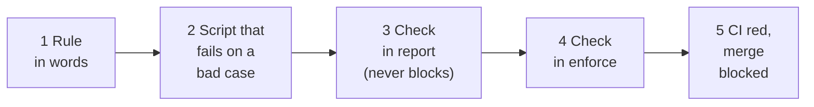

# How protection works

> **In one line:** a rule protects you only once it is a registered check that CI enforces. Everything else depends on someone reviewing.

Read as far as you need. **Level 1** takes ten seconds, **Level 2** two minutes, **Level 3** is reference material you can open when you need it.

## Level 1: the idea (10 seconds)

A rule goes from words to a blocked merge in five steps. The first step is only a document. Only from step 3 does a machine check anything.



Three kinds of protection, strongest first:

| Kind | What stops the mistake | Blocks a bad merge? |
| --- | --- | --- |
| **Design** | The invalid state cannot be written, for example a type or a module boundary. | Yes, when the build runs in CI |
| **Mechanical** | A registered check fails, for example a lint rule or an import-rule script. | Yes, once enforced and required |
| **Semantic** | A written rule that a reviewer or `$gov-check` judges against its source document. | **No.** Review is the only coverage |

## Level 2: what happens to a bad file (2 minutes)

Same violating file, two situations. Top: the check is enforced. Bottom: it is still in report mode.


Read it like this:

1. **Dashed stations cannot stop a change.** The hook, your local `check` and the AI review only inform.
2. **CI can mark the commit red,** but only for an enforced check. A report-mode finding is listed and CI stays green.
3. **Branch protection is what blocks the merge.** It is a GitHub setting, outside this repository.

What each part is:

| Part | Nature | What it does |
| --- | --- | --- |
| Runtime and CI | Hard, deterministic | Runs the registered checks. Sees only what was registered. |
| Skills such as `gov-check`, `gov-rule`, `gov-issue` | Soft, instructions to the AI | Judge meaning, choose protection, read each rule's source document. Nothing forces the AI to follow them. |

### What this cannot do

- It does not learn your design patterns. Every pattern must first be written as a script or a documented rule.
- A check is as good as its script. A regex for `createHandler` is satisfied by a comment containing the word.
- `report` mode does not block on findings, so a rule left in `report` protects nothing.
- CI alone does not stop a merge. Branch protection must require the check.
- The runtime trusts the candidate's own `.governance/`, scripts and CI workflow. Protect those with required review, for example CODEOWNERS.
- The hook never blocks, and the new source-review and Change map behavior has not been run in a fresh session.

A passing result means the declared checks passed. It does not mean the code is correct.

## Level 3: reference

<details>
<summary><b>Config, rules and check kinds</b></summary>

&nbsp;

| File | Role | Owned by |
| --- | --- | --- |
| `.governance/config.json` | The **detectors**: which checks exist, what they run, their mode. | Your project |
| `.governance/rules.json` | The **register**: invariant, owner, source document, proof file, enforcing check. | Your project |
| `.governance/runtime/*.mjs` | The engine that runs the checks. | The toolkit, updated by `gov-setup` |

A rule needs a check or a `textReason`. A check can exist without a rule.

```json
{
  "id": "cms-handler-pattern",
  "owner": "cms-team",
  "scope": ["cms/modules"],
  "source": ["docs/cms-pattern.md"],
  "proof": ["scripts/check-cms-pattern.mjs"],
  "enforcement": { "check": "cms-pattern" }
}
```

`scope` covers a path that equals it or is a parent directory of it. There are no globs. `proof` must be non-empty when enforcement is a `check`. A design protection is recorded as the `command` check that runs the type checker or build.

| Check kind | Reports a finding when | `paths` means |
| --- | --- | --- |
| `registry` | A path named in `rules.json` no longer exists. | The register file |
| `links` | A Markdown link is broken. | Files to scan |
| `size` | A file exceeds `maxBytes` or `maxLines`. | Files to measure |
| `command` | Your command exits non-zero. | A label only. The script decides what it covers. |

Only `command` can express a rule about meaning or design.

</details>

<details>
<summary><b>Modes and exit codes</b></summary>

&nbsp;

| Command | Report-mode check with a finding | Enforce-mode check with a finding | An error |
| --- | --- | --- | --- |
| `report` | 0 | 0 | 2 |
| `check` (what CI runs) | 0 | **1** | 2 |
| `activate` | 1, nothing changes | n/a | 2 |

An **error** means the tool could not do its job: invalid config, a missing path in any check's `paths`, or a command that cannot start or times out. It exits 2 in every mode, so a report-mode check can still turn CI red.

A new check starts in `report`. `activate` makes it `enforce` only when a fresh run shows zero findings. There is no baseline file. If old code violates the rule, fix it or stay in `report`. Nothing in the runtime stops someone editing the config or script to weaken a check, so review has to catch that.

</details>

<details>
<summary><b>How a changed path is matched to protection</b></summary>

&nbsp;

| The path is... | Covered by | A review can say |
| --- | --- | --- |
| In a rule's scope, rule has a check | That check, plus review of the `source` | Machine result and judgment, kept separate |
| In a rule's scope, rule has `textReason` | Review only | "No mechanical protection exists" |
| Outside every rule, inside a check's `paths` | That check, if its script covers it | "Checked, no rule documents it" |
| In neither | No registered protection | "Rule-uncovered", judged against traced contracts |

Rule scope and check coverage are separate. The runtime does not verify that a rule's named check covers its scope. The hook uses check `paths`: it runs `links` for any edit, `registry` for paths a rule references, and every quick check when `config.json` or `rules.json` is edited.

</details>

<details>
<summary><b>When each stage can notice a violation</b></summary>

&nbsp;

| Stage | Runs | Blocks? |
| --- | --- | --- |
| Hook, as the AI edits | `registry`, `links`, `size` only. Never `command` checks. | No. Output is context for the AI. |
| `check` before push | Every registered check | Only if you act on it |
| `$gov-check` before the PR | Native checks plus semantic review of rule sources | No. The AI returns `pass`, `issues`, `blocked` or `partial`. |
| CI on push and pull request | `check --root .` | Red for an enforced finding, or an error in any mode |
| Branch protection | Requires the CI check | **Yes**, if configured |
| `$gov-maintain`, when you ask | Rule and check health | No |

</details>

<details>
<summary><b>Worked example: a file that breaks a pattern</b></summary>

&nbsp;

Every module under `cms/modules` must `export default createHandler(...)`, as written in `docs/cms-pattern.md`. A pull request adds `newFiles.js`, which uses `require` and a raw function. Run in a throwaway repository with the real runtime:

| Situation | Result |
| --- | --- |
| No rule or check | `check` passes, exit 0. Nothing is noticed mechanically. |
| `command` check, `report` mode | Finding listed, exit 0, CI green. The file can merge. |
| Same check, `enforce` mode | `command exited 1` plus the script's message. Exit 1, CI red. |
| Enforced, and the AI edits the file | The hook is silent. It does not run `command` checks. |
| Only a `textReason` rule | Mechanically a pass. `gov-check` is instructed to read the source and flag it. |

</details>

<details>
<summary><b>What each skill adds</b></summary>

&nbsp;

| Skill | Contribution |
| --- | --- |
| `gov-setup` | Installs runtime, config and optional hook. It does not edit your CI; it asks the AI to wire `check` into your workflow. |
| `gov-audit` | Finds authorities, behavior, consumers and existing protection. |
| `gov-rule` | Chooses the protection kind and proves it with a failing bad case and a passing good case. |
| `gov-check` | Reviews a candidate against rule sources and consumers and reports where only review covered a path. |
| `gov-doc-sync` | Reconciles documents with changed behavior. |
| `gov-maintain` | Repairs governance drift without weakening protection. |
| `gov-issue` | Files a ticket with a Change map: each path to create, update or delete, its governing source and its protection. |

</details>

<details>
<summary><b>Checklist for a new rule</b></summary>

&nbsp;

1. State the invariant, its owner and the document that holds the rule.
2. Prefer removing the mistake by design. Otherwise write a script or test that fails on a bad case and passes on a good one.
3. Register the check in `report` mode and record the rule in `rules.json`.
4. Clear every finding, then `activate`.
5. Make CI run `check`, require it in branch protection, and require review for `.governance/` and the check scripts.
6. If a mechanical check is unsuitable, record a `textReason` and accept that review is the only coverage.

</details>

See [usage scenarios](usage-scenarios.md) for commands, [getting started](getting-started.md) for the first run, and [troubleshooting](troubleshooting.md) when something looks wrong.
