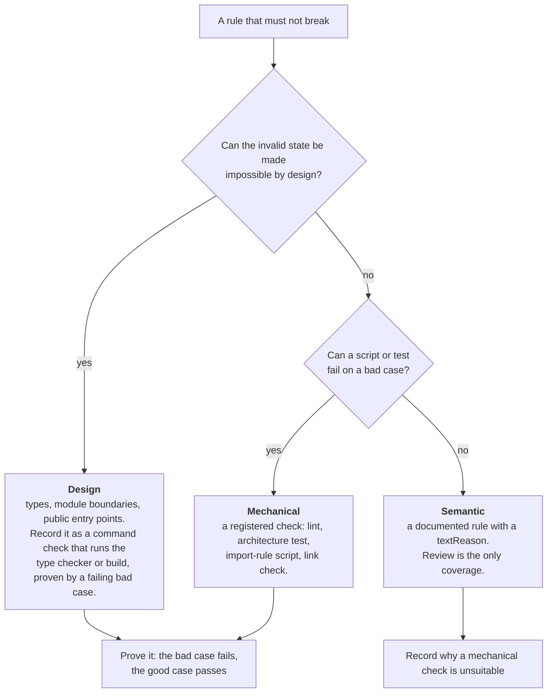
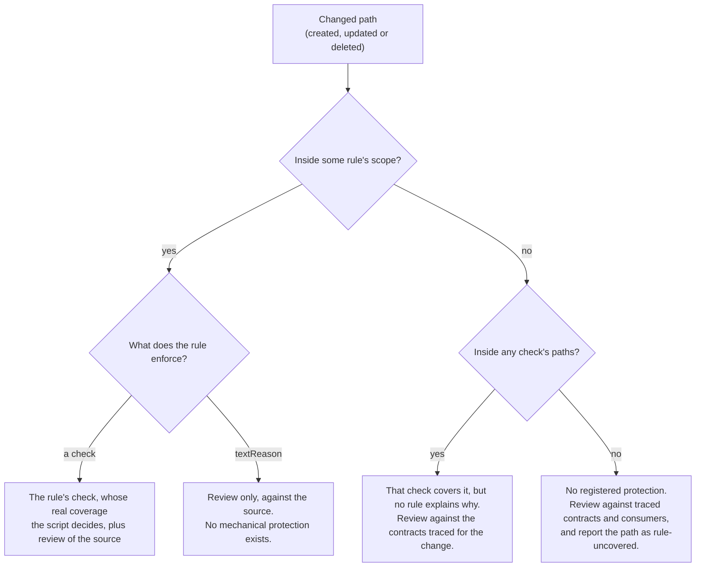
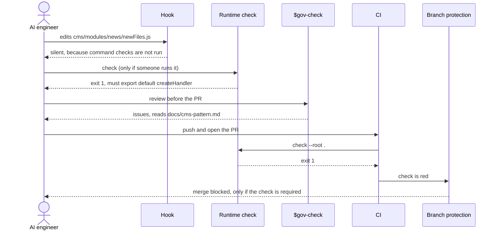
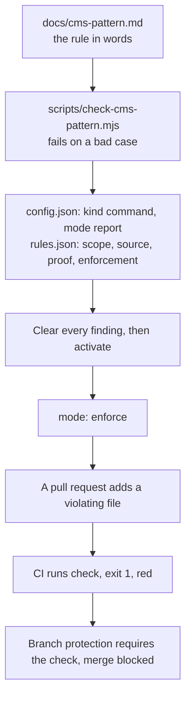

# How protection works

This page explains what protects a repository, how a violation gets noticed, and where each kind of protection stops. Read it to learn what you can rely on and what you must still review yourself.

## The one idea

Gov Skills governs how an AI engineer changes code. It does this in two layers that fail in different ways.

| Layer | What it is | Strength | Weakness |
| --- | --- | --- | --- |
| Runtime and CI | `.governance/runtime/*.mjs` runs registered checks. CI runs them once you wire it in (see [what each skill adds](#what-each-skill-adds)). | Deterministic. The same input gives the same result, whatever the AI believes. | Sees only what was registered. It cannot judge meaning. |
| Skills | `SKILL.md` instructions the AI follows: `gov-check`, `gov-audit`, `gov-rule` and the rest. | Can judge meaning, intent and consistency. | They are instructions. Nothing forces the AI to follow them. The routing corpus has not been run, and the source-review and Change map behavior is untested in fresh sessions. |

A violation is caught mechanically only when someone turned the rule into a registered check. Otherwise it depends on review.

## Three kinds of protection

When a rule matters, `gov-rule` picks the strongest kind that fits, in this order.



| Kind | How it protects | Example | Strength |
| --- | --- | --- | --- |
| **Design** | The invalid state cannot be written or cannot exist. | A type with no way to express the bad value. A module that exports only its public entry. | Strongest, but it only holds while the compiler or build actually runs. Register that run as a `command` check. |
| **Mechanical** | A registered check fails when the rule is broken. | A lint rule, an architecture test, an import-rule script, a link check. | Hard when the check is in `enforce` mode and CI is required. |
| **Semantic** | A written rule that review judges against its source document. | "New modules follow the pattern in `docs/cms-pattern.md`." | Soft. Review is the only coverage. |

How to choose:

- Prefer removing the possibility of the mistake over detecting it.
- Use text-only protection only with a specific reason why a mechanical check is unsuitable. It is recorded as `textReason`.
- Reuse or improve an existing check before adding a second one.
- `rules.json` records either a `check` or a `textReason`. A design protection therefore appears as the `command` check that runs the type checker or build, with the counterexample as `proof`.

## What the files hold

| File | Role | Owned by |
| --- | --- | --- |
| `.governance/config.json` | The **detectors**: which checks exist, what they run, their mode. | Your project |
| `.governance/rules.json` | The **register**: which invariant matters, who owns it, which document states it, which file proves it, and which check enforces it. | Your project |
| `.governance/runtime/*.mjs` | The engine that runs the checks. | The toolkit (updated by `gov-setup`) |

A rule points at a check. A check can exist without a rule, but a rule needs a check or a `textReason`.

```json
{
  "id": "cms-handler-pattern",
  "owner": "cms-team",
  "scope": ["cms/modules"],
  "source": ["docs/cms-pattern.md"],
  "proof": ["scripts/check-cms-pattern.mjs"],
  "enforcement": { "check": "cms-pattern" }
}
```

| Field | Meaning |
| --- | --- |
| `scope` | Which paths the invariant covers. Real repo-relative paths, no globs. A scope covers a path when it equals the path or is a parent directory of it. |
| `source` | The document that states the rule. A reviewer judges a change against it. |
| `proof` | The file that demonstrates the rule is effective, usually a test or script. It must be non-empty when the enforcement is a `check`. |
| `enforcement` | Either `{ "check": "<id>" }` or `{ "textReason": "why a check is unsuitable" }`. |

## The four check kinds

| Kind | Reports a finding when | What `paths` means | Cost to set up |
| --- | --- | --- | --- |
| `registry` | A path named in `rules.json` no longer exists. | The register file. | Built in. |
| `links` | A Markdown link points to a missing file or heading. | The Markdown files to scan. | Built in. |
| `size` | A file exceeds `maxBytes` or `maxLines`. | The files to measure. | Built in. |
| `command` | The command you register exits non-zero. | A declared label only. The script decides what it really covers. `paths` is checked for existence and used to decide when the hook runs. | You write the script or test. |

Only `command` can express a rule about meaning or design, such as "no module imports another module's internals". The other three check structure. If you want the machine to catch a design pattern, you need a script that fails on a bad case.

## Modes and exit codes

A check is in `report` mode or `enforce` mode. A new check starts in `report`.

| Command | Check in `report` mode with a finding | Check in `enforce` mode with a finding | A check or the config has an error |
| --- | --- | --- | --- |
| `report` | exit 0 | exit 0 | exit 2 |
| `check` (what CI runs) | exit 0 | **exit 1** | exit 2 |
| `activate` | exit 1, nothing changes | n/a | exit 2 |

An **error** is not a finding. It means the tool could not do its job: an invalid config, a missing path in any check's `paths`, or a command that cannot start or times out. Errors fail `check` with exit 2 in every mode, so a `report`-mode check can still turn CI red.

`activate` turns the selected checks to `enforce` only when a fresh run shows zero findings. The runtime has no baseline file, so it cannot excuse an existing violation. If old code violates the rule, fix it or keep the check in `report`. The runtime does not stop someone editing `config.json` or the script to weaken a check. The skills forbid that, and review has to catch it.

## How a change is identified

A change is matched to protection by path. Three different things do the matching.

| Matching | Used by | How |
| --- | --- | --- |
| Check `paths` | The runtime and the optional hook | For built-in kinds, `paths` is what is scanned. The hook runs a quick check when an edited file overlaps those paths. `registry` also runs for a path a rule references, `links` runs for any edit in the repository, and every quick check runs when an edit touches `config.json` or `rules.json`, names no path, or has only relative paths without a working directory. |
| Rule `scope` | `gov-check`, `gov-issue`, and the runtime's `registry` check | The rule declares which paths its invariant covers. A reviewer maps each changed path to the rules whose scope contains it, then reads their `source`. |
| Consumers | `gov-audit`, `gov-check` | The AI traces real callers, schemas, configuration and docs. A declared scope seeds this and does not prove completeness. |

Rule scope and check coverage are separate. The runtime does not verify that the check named by a rule actually covers the rule's scope. For a `command` check the script alone decides.



| The path is... | Covered by | What a review can say |
| --- | --- | --- |
| In a rule's scope with a check | The check, plus review of the `source` | Mechanical result and semantic judgment, kept separate |
| In a rule's scope with `textReason` | Review only | "No mechanical protection exists" |
| In no rule's scope but inside a check's `paths` | That check, if its script covers it | "Checked, no rule documents it" |
| In neither | No registered protection | "Rule-uncovered". Judge it against traced contracts. It is not automatically a failure. |

## When a violation can be noticed

The animation shows the same violating file in two situations: the check is already enforced, and the check is still in report mode. The hook, the local check and the AI review sit on the path in both lanes. None of them can stop the change.


The same story as a sequence, with the check enforced:



| Stage | Runs | Blocks? | Notes |
| --- | --- | --- | --- |
| Hook, as the AI edits | `registry`, `links`, `size` only | No | Never runs `command` checks, so a pattern script is silent here. Its output is context for the AI. The hook itself exits 0, though a host reports a failure if Node or the adapter cannot start. Real host triggering is not verified. |
| `check` before push | Every registered check, including `command` | Only if you act on it | Run it yourself: `node .governance/runtime/cli.mjs check --root .` |
| `$gov-check` before the PR | Native checks plus semantic review | No | The AI reads rule sources and consumers. Its result is `pass`, `issues`, `blocked` or `partial`. |
| CI on push and pull request | `check --root .` | Marks the commit red for an `enforce` finding, or for an error in any mode | A `report`-mode finding does not fail it. |
| Branch protection | Requires the CI check to pass | Yes | A GitHub setting outside this repository. Without it, a red check can still be merged. |
| `$gov-maintain`, when you ask | Rule and check health | No | Looks for unused, obsolete or stale rules and proofs, duplicate authorities and drift. It is not a scheduler. |

## Worked example: a file that breaks a pattern

Setup: every module under `cms/modules` must `export default createHandler(...)`, as written in `docs/cms-pattern.md`. A pull request adds `cms/modules/news/newFiles.js`, which uses `require` and a raw function. This was run in a throwaway repository with the real runtime.

| Situation | Result |
| --- | --- |
| No rule or check for the pattern | `check` passes, exit 0. Nothing is noticed mechanically. |
| A `command` check exists, mode `report` | The finding is listed, exit 0. CI is green and the file can merge. |
| The same check in mode `enforce` | The runtime records `command exited 1` and prints the script's own message, `cms/modules/news/newFiles.js: must export default createHandler(...)`. Exit 1, CI red. |
| The check is enforced and the AI edits the file | The hook stays silent. It does not run `command` checks. |
| Only a `textReason` rule points at the document | Mechanically a pass. `gov-check` is instructed to read the source, flag the file, and state that review was the only coverage. |

The path from idea to blocked merge:



## What each skill adds

| Skill | Contribution to protection |
| --- | --- |
| `gov-setup` | Installs the runtime, config and optional hook. It does not edit your CI. It asks the AI to wire `check` into your existing workflow after an audit. |
| `gov-audit` | Finds which authorities, behavior and consumers exist and what already protects them. |
| `gov-rule` | Chooses the protection kind, proves it with a failing bad case and a passing good case, records it. |
| `gov-check` | Reviews a candidate against rule sources and consumers, runs native checks, and reports where only review covered a path. |
| `gov-doc-sync` | Reconciles documents with changed behavior. |
| `gov-maintain` | Repairs governance drift and consolidates rules without weakening protection. |
| `gov-issue` | Files a ticket with a Change map: each path to create, update or delete, its governing source and its protection. |

## What this cannot do

| Limit | Consequence |
| --- | --- |
| It does not learn your design patterns. | Every pattern must be written as a script or a documented rule first. |
| Skills are instructions. | An AI can skip a step. Only the runtime and CI are hard. |
| The runtime trusts the candidate. | A change can edit `.governance/config.json`, a check script or the CI workflow. Protect those with required review, for example CODEOWNERS. |
| A check is as good as its script. | A regex that looks for `createHandler` is satisfied by a comment containing that word. |
| Rule `scope` is trusted. | With a `registry` check the runtime verifies that scope paths exist, not that they cover what the rule claims or that the named check covers them. |
| `report` mode does not block on findings. | A rule left in `report` protects nothing, though an error still fails `check`. |
| `registry` checks references, not behavior. | It reports a deleted proof or source file and says nothing about whether the proof is good. Starting in `report` mode, a deleted `source` is listed and CI stays green. |
| CI does not stop a merge by itself. | Branch protection must require the check. |
| The hook is feedback. | It runs only quick checks and never blocks the edit. |

A passing result means the declared checks passed. It does not mean the code is correct.

## A short checklist for a new rule

1. State the invariant, its owner and the document that holds the rule.
2. Prefer removing the mistake by design. If that is not possible, write a script or test that fails on a bad case and passes on a good one.
3. Register the check in `report` mode and record the rule in `rules.json`.
4. Clear every finding. Then `activate` the batch.
5. Make sure CI runs `check`, that branch protection requires it, and that changes to `.governance/` and the check scripts need review.
6. If a mechanical check is unsuitable, record a `textReason` and accept that review is the only coverage.

See [usage scenarios](usage-scenarios.md) for commands, [getting started](getting-started.md) for the first run, and [troubleshooting](troubleshooting.md) when something looks wrong.
