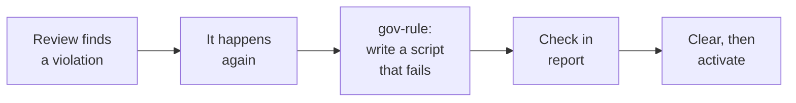

# How semantic protection works

> **In one line:** a semantic rule is a document that an AI reads and judges a change against. No code decides pass or fail, so it informs a human and never blocks a merge by itself.

This is the soft half of [how protection works](how-it-works.md). It covers rules that have a `textReason` instead of a check, and what `$gov-check` does with the rule's `source` document.

## The idea in 10 seconds

| | Mechanical protection | Semantic protection |
| --- | --- | --- |
| Who decides | A script, by exit code | An AI, by reading |
| Same input, same answer? | Yes | **Not guaranteed** |
| Starts by itself in CI? | Yes | **No**, someone must ask for the review |
| Result | Red or green | A written report |
| Blocks a merge? | Yes, if enforced and required | **No** |
| Good for | Anything a program can test | Judgment: naming, clarity, consistency, fit with a design |

## What happens in one review (2 minutes)

The same run, step by step. The paths and rule are an illustration, not a recorded run.

| Step | What happens | Hard or soft |
| --- | --- | --- |
| **0. Register** | A rule in `.governance/rules.json` names the `scope`, the `source` document and a `textReason`. The runtime only checks that those paths exist. A `registry` check reports a missing one, and that fails CI only if the check is enforced. | Hard, but shallow |
| **1. Ask** | Someone runs `$gov-check` on a branch, commit or PR. The `gov-issue` ticket checklist includes this step. CI does not run it. | Soft: it depends on someone asking |
| **2. Identify the change** | `gov-check` records the base, head and hashes, and includes created, deleted and renamed paths. | Soft: instructions |
| **3. Match by scope** | Each changed path is mapped to the rules whose `scope` equals it or is a parent directory. A path in no rule is listed as rule-uncovered, with a note on whether a registered check covers it. | Soft: instructions |
| **4. Read the source** | The AI reads the `source` document of each matching rule, and traces real callers, consumers and docs for the change. | Soft: depends on what it reads |
| **5. Judge and report** | It returns `pass`, `issues`, `blocked` or `partial`, with file, line, impact and a concrete correction for each finding. It keeps machine results and its own judgments separate, and states which requirements had review-only coverage. | Soft: model judgment |

## How to read the result

| Outcome | Meaning | You should |
| --- | --- | --- |
| `pass` | The required coverage was done, no unresolved relevant findings, evidence is fresh. | Remember it still says "reviewed", not "proved". |
| `issues` | A supported violation with file, line and impact. | Fix it, or decide the rule is wrong. |
| `blocked` | A needed tool, decision or input was missing. | Supply it and ask again. |
| `partial` | Only part was checked, and it says which part. | Decide whether the gap matters. |

## Where it can go wrong

| Weak point | What happens | What helps |
| --- | --- | --- |
| Nobody asks for the review | Nothing is judged, and nothing says so | Put `$gov-check` in the ticket and PR checklist. Do not treat a green CI as a review. |
| `scope` is wrong or too narrow | The rule never matches the path | Keep `scope` as the real directories. The runtime does not verify that it covers what you meant. |
| The source is vague | The AI guesses what "clean" means | Write testable sentences (see below). |
| The AI skips or misreads a step | A real violation is missed | Treat the report as evidence to check, not as an answer. |
| The same finding keeps returning | Judgment is doing a program's job | Promote it to a check. |

These behaviors are instructions in `skills/gov-check/SKILL.md`. They have not been run in a fresh Codex session, so treat the review as a strong prompt, not a guarantee.

<b>Which rules belong here</b>

&nbsp;

Choose semantic protection only when a program cannot test the rule.

| Rule | Best protection |
| --- | --- |
| "Every module exports `createHandler(...)`" | **Mechanical.** A script can check it. The `cms/modules` example elsewhere in these docs is really a candidate for a check. |
| "Error messages tell the user how to fix the problem" | Semantic |
| "Names use the domain's vocabulary" | Semantic |
| "A change to a public API has a migration note" | Mechanical if the note has a fixed place, otherwise semantic |
| "This module must not import another module's internals" | Mechanical, or design by a public entry point |

If a mechanical check is possible, `gov-rule` prefers it. A `textReason` must say why one is unsuitable.

<b>Writing a source document a review can use</b>

&nbsp;

This is guidance, not something the runtime enforces.

- State one requirement per sentence, in a form you could answer yes or no.
- Name paths and symbols instead of "the usual way".
- Give one good example and one bad example.
- Say what the requirement protects, so the AI can judge cases you did not list.
- Keep it short. A reviewer reads the whole file for every matching change.

| Weak | Better |
| --- | --- |
| "Handlers should be clean." | "Every file in `cms/modules` exports a default `createHandler({...})`. A raw function or `module.exports` is a violation." |
| "Be consistent with the API style." | "New endpoints return `{ data, error }`. See `src/api/news.ts` for an example." |

<b>From review to check: promoting a recurring finding</b>

&nbsp;

Each time a review catches the same thing, a program can probably catch it for free. Semantic protection is how a rule starts. A check is where it should end up when it can.

Back to [how protection works](how-it-works.md).
